<h1 align="center">Hola, soy Matias Rodrigo Sánchez-Maza 👋</h1>

  <b>Desarrollador de software · Estudiante de DAM · Tarragona</b> 
  Back-end, ERP (Odoo) y aplicaciones multiplataforma

  
  

---

## 👨‍💻 Sobre mí

Estudio el **Grado Superior de Desarrollo de Aplicaciones Multiplataforma (DAM)** en el Institut Vidal i Barraquer y trabajo como **desarrollador en Synkiria**, donde participo en proyectos reales para clientes: aplicaciones web, desarrollos a medida y personalización de **Odoo**.

Me interesa construir software sólido por dentro (lógica de negocio, datos, integraciones) sin descuidar la experiencia de usuario. En mi tiempo libre desarrollo proyectos personales, sobre todo **videojuegos con Godot** y **aplicaciones** que resuelven problemas de mi día a día.

---

## 🛠️ Tecnologías

| Área | Tecnologías |
| :--- | :--- |
| **Back-end** |   |
| **ERP** |  |
| **Front-end** |    |
| **Videojuegos** |   |
| **Herramientas** |   |

---

## 🚀 Proyectos en desarrollo

| Proyecto | Descripción | Tecnología |
| :--- | :--- | :--- |
| **🕳️ Vacío** | Juego 2D de habilidad en vista cenital con forma de embudo: 12 niveles que descienden por las capas de la Tierra, de la corteza al núcleo, aumentando la dificultad y reduciendo la visión. Desarrollado en equipo de 3 personas con Git. | Godot · GDScript |
| **♟️ Ajedrez 3D** | Ajedrez en 3D inspirado en el ajedrez mágico de Harry Potter: piezas de piedra que se rompen en fragmentos con físicas al ser capturadas. Modo local para 2 jugadores y modo contra IA (minimax propio). | Godot |
| **🏆 Rift Manager** | Juego de gestión de esports ambientado en League of Legends: ligas, academias, varias regiones y Worlds, con partidas simuladas en un mapa 2D animado. | Godot · GDScript |
| **🚌 EMT Tarragona** | Rediseño de la web de autobuses urbanos de Tarragona con paradas, líneas y horarios reales a partir de los datos abiertos GTFS. | Web · GTFS |
| **🤖 Jarvis** | Asistente de voz personal inspirado en JARVIS, ejecutado 100 % en local. | Python · IA local |

---

## 💼 Experiencia

- **Desarrollador de software — Synkiria** *(julio 2026 – actualidad)*
  Desarrollo de aplicaciones web y soluciones a medida para clientes, personalización de Odoo, despliegue en servidores de cliente y mantenimiento evolutivo según sus peticiones.

---

## 🌍 Idiomas

Castellano y catalán (nativo) · Inglés (B1/B2) · Francés (básico)

---

  
  

